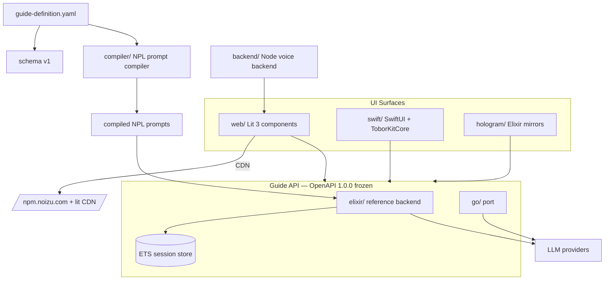

# Project Architecture

## Overview

tobor-kit is a reusable **agent-guide component kit**: one YAML guide
definition, compiled to NPL prompts, served over a frozen OpenAPI contract,
and rendered by parallel UI surfaces (Lit 3 web components, SwiftUI mirrors,
Elixir Hologram mirrors). The architecture is contract-first — schema and
OpenAPI are frozen (v1 / 1.0.0) and every surface implements against them,
so the Elixir reference backend and its Go port stay interchangeable.

## System Diagram

## Core Components

| Component | Purpose |
|-----------|---------|
| schema + openapi | Frozen contracts: guide definition (YAML v1) + Guide API (3.1) |
| compiler | YAML → NPL prompt compilation (Elixir) |
| elixir | Reference backend: sessions, turns, providers, voice gateway |
| go | Backend port implementing the same OpenAPI contract |
| web | `@noizu/tobor-kit` Lit 3 package, published to npm.noizu.com + CDN |
| swift | SwiftUI surfaces (ToborKitCore: auth/PKCE, SSE, voice, transcript) |
| hologram | Native Elixir Hologram mirrors of presentational Lit components |
| backend | Node 22+ voice/session reference backend for `<tobor-voice-agent>` |
| logical-layout | Read-only symlink nav view across all trees |

→ *Components ↔ directories: see [PROJ-LAYOUT.md](PROJ-LAYOUT.md)*

## Data Flow

A guide definition validates against the schema, is compiled by `compiler/`
into NPL prompts, and is served by the Guide API. Clients create sessions,
execute turns (session state held in volatile ETS — no relational store),
and stream completions/transcripts; voice flows through the voice gateway /
Node voice backend alongside (not replacing) the Guide API.

→ *See [PROJ-SCHEMA.md](PROJ-SCHEMA.md) for data contracts*

## UI Surface Strategy

Lit components are canonical; `web/registry.yaml` is the frozen name
directory (tags, classes, slots, data-cy, events) that the SwiftUI and
Hologram mirrors copy verbatim — mirrors never invent hooks or modify `web/`.
Hologram Phase 1 covers presentational components only; server-coupled
families stay Lit-side (interface contract: `hologram/docs/PORTING.md`).

## Infrastructure

Vendored Helm chart (`helm/tobor-kit`) deploys the backend image
(`ops.noizu.com/tobor-kit/backend`, CI-bumped `sha-*` tags, Infisical for
secrets). Lit package publishes to npm.noizu.com and the CDN via
`.github/workflows/publish-lit.yml`; CI in `ci.yml`. Isolation validation
of lit components runs via Makefile cypress targets.

## Key Decisions

- **Contract-first, frozen schemas**: schema v1 + OpenAPI 1.0.0 frozen so
  six surfaces can implement independently without drift.
- **Elixir reference / Go port**: one canonical implementation, one port —
  both against the same contract.
- **No relational DB**: sessions are volatile ETS state; the kit is a
  component library, not a system of record.
- **CDN cache-busting over purging**: stale CDN assets get `?vsn=`
  content-hash query params.
- **Mirror discipline**: registry.yaml as single naming authority keeps
  Lit/SwiftUI/Hologram surfaces testably aligned.
