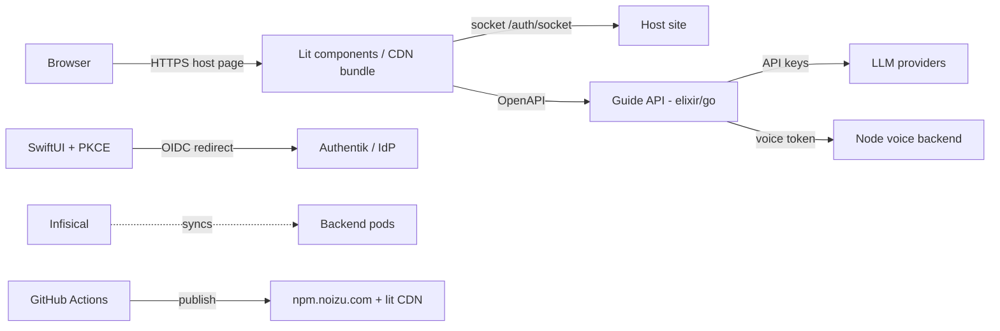

# Threat Model

## Overview

tobor-kit's crown jewels are: OIDC/PKCE auth flows (kit code handling nonces,
verifiers, tokens), LLM provider credentials (egress), the voice token
endpoint, and the CDN-published lit bundle (supply chain — anything poisoned
there ships to every embedding site). The kit is a **library**: hosts embed
the components and own the perimeter (ingress, TLS, rate limits, session
storage). Trust boundaries: public internet ↔ host site ↔ kit components ↔
Guide API backends ↔ LLM providers / OIDC IdP.

## Attack Surface

→ *See [threats/attack-surface.md](threats/attack-surface.md) for the full
enumeration*

## Vulnerability Register

| ID | Severity | STRIDE | Component | Status |
|----|----------|--------|-----------|--------|
| T-001 | High | Spoofing | OIDC callback: ID token must verify signature/iss/aud/exp + nonce; mismatched nonce rejected | Mitigated (`elixir/.../auth/oidc.ex`) |
| T-002 | High | Spoofing | Auth socket: origin must exactly match scheme/host/port; missing/malformed/foreign fail closed | Mitigated (dev-only override list) |
| T-003 | High | Spoofing/Tampering | Auth handoff nonce ≥128-bit entropy, code bound to nonce, atomic redeem + rotation; CSRF checks delegated to host | Partial — entropy + rate limiting are host obligations |
| T-004 | Medium | Info disclosure | Tokens never placed in socket results or browser events | Mitigated (auth-socket contract) |
| T-005 | Medium | Info disclosure | ETS session store is in-process, volatile, public table | Accepted — no persistent PII by design; host owns durable sessions |
| T-006 | Medium | DoS | Turn/session endpoints rely on host-level rate limiting | Open — host obligation, documented |
| T-007 | Medium | Tampering | CDN lit bundle supply chain (CI publish path) | Partial — CI-scoped publish; cache-bust via `?vsn=` |
| T-008 | Low | Info disclosure | Account-existence oracle in login flows — hosts must avoid differential responses | Open — host obligation, documented in auth-socket.md |
| T-009 | Low | Repudiation | Telemetry consent endpoint — consent state host-managed | Partial |

## Mitigation Coverage

4 mitigated · 3 partial · 2 open. Open/partial items are contract-level
obligations pushed to embedding hosts and documented in
[`auth-socket.md`](auth-socket.md) — the kit fails closed where it acts and
names the host's duty where it cannot.

→ *See [threats/authn-authz.md](threats/authn-authz.md) for control details*

## Residual Risk

Kit is a library deployed inside host perimeters: host rate limiting, nonce
entropy, and account-enumeration hygiene are accepted as host obligations.
ETS volatility accepted (component kit, not a system of record).

*Grounding: [PROJ-ARCH.md](PROJ-ARCH.md) · [PROJ-LAYOUT.md](PROJ-LAYOUT.md)*
